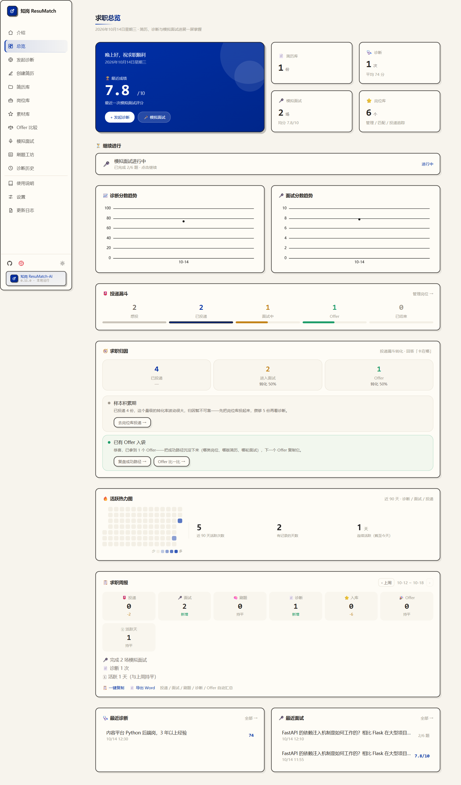
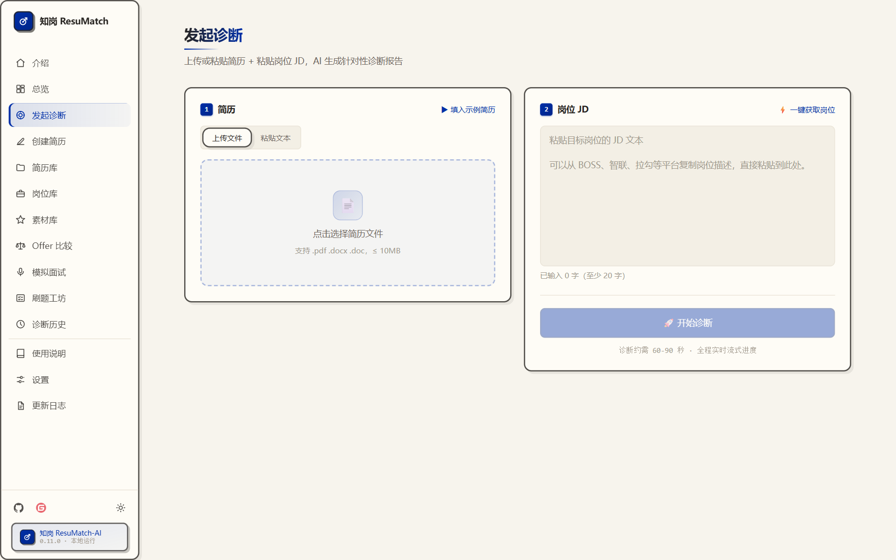
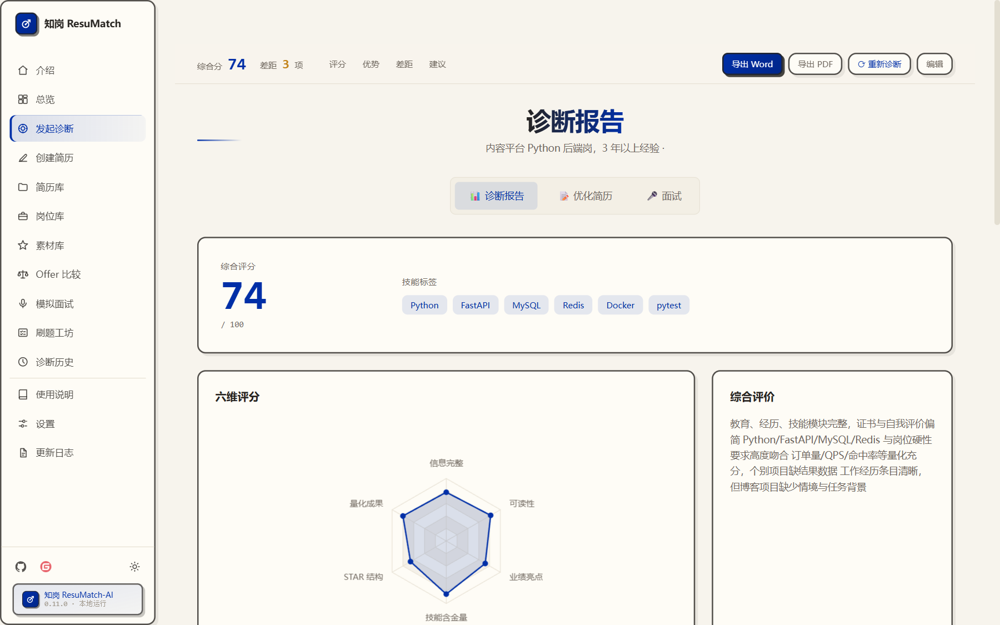
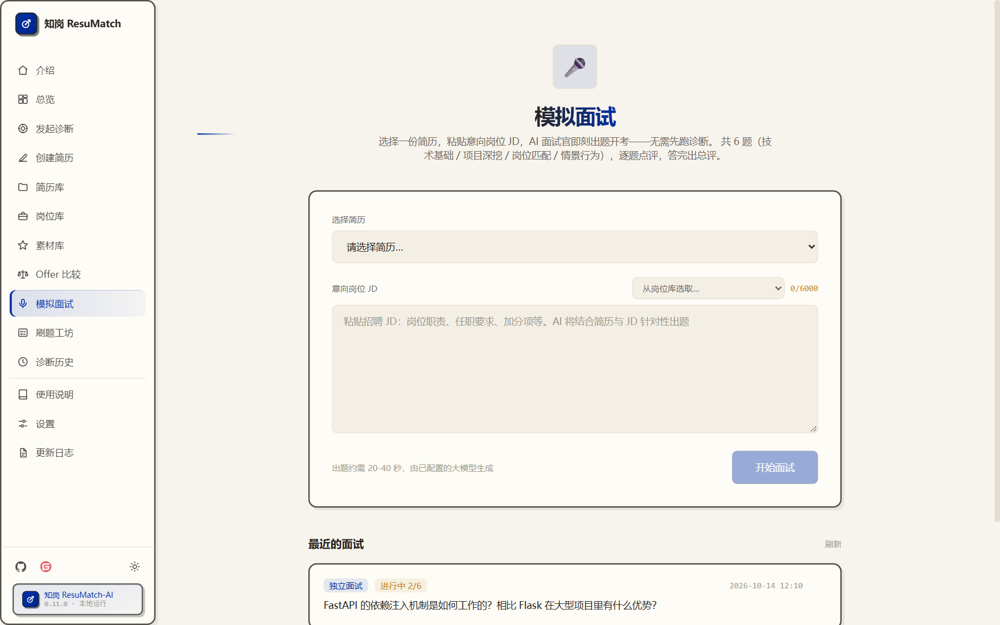
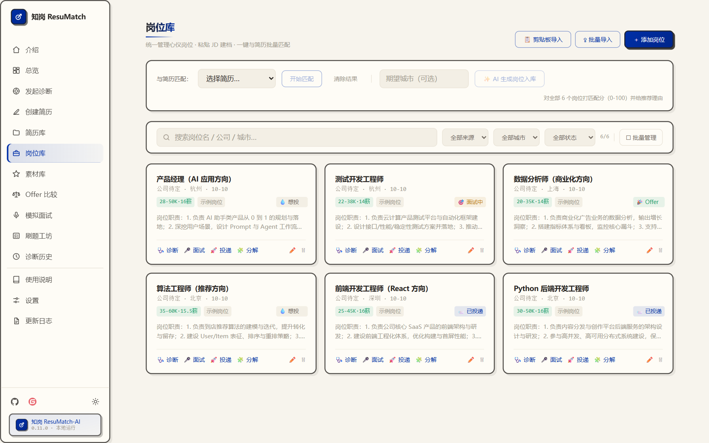
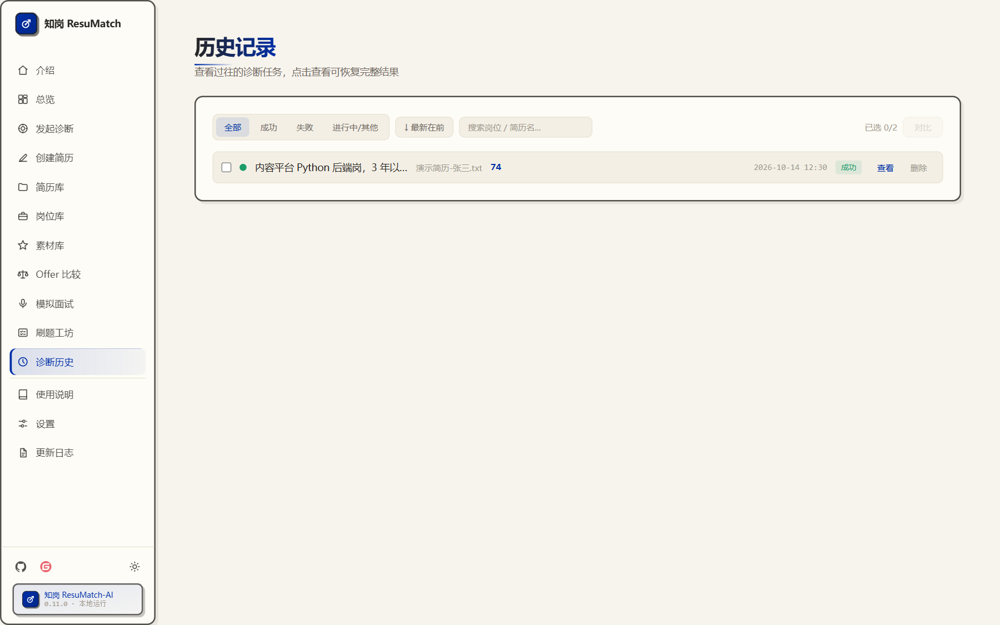
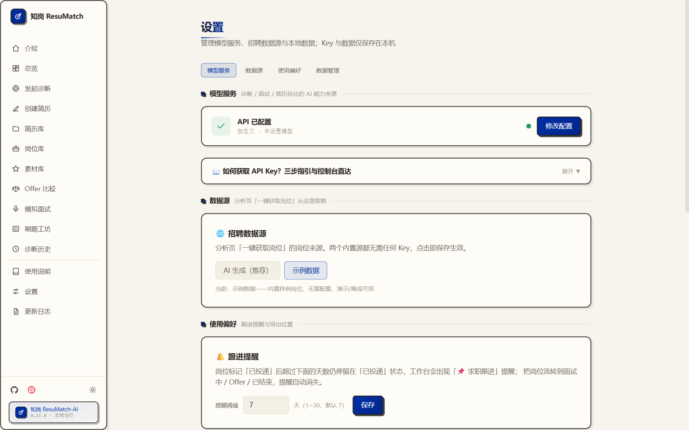

# 知岗 ResuMatch-AI

> 中文名：**知岗** ｜ 英文名：**ResuMatch-AI**（v0.11.0）
> 知岗，意在**读懂岗位所求，认清自身所长**——一站式 AI 求职工作台：简历诊断 → 对答式优化 → 岗位库与投递直达 → 刷题笔试 → 模拟面试实战评分 → Offer 比较决策，求职全流程一个应用搞定

求职投递里常见的困境，是求职者仅凭主观感受撰写简历，难以精准捕捉招聘 JD 背后的核心诉求，导致简历内容与岗位要求错位，投递石沉大海；改完简历不知道有没有变好，面试没处练，手握多个 Offer 拍板没依据。

本项目基于 **LangGraph 多智能体架构**，把「找工作」这条链路变成**可量化、可复盘的闭环**。不同于简单的文本润色工具，**知岗是求职者的岗位需求分析师**：以岗位 JD 作为标尺，客观比对简历与岗位之间的差距，抹平求职者和招聘方之间的信息差，让简历不再是经历的堆砌，而是对岗位需求的有效回应。

- 上传简历、粘贴目标岗位 JD，AI 六维评分并逐条指出与岗位的差距（每条引用简历原文佐证）
- 改完简历一键重诊对比进度；岗位库锁定期望岗位、生成投递材料包、四平台搜索深链直达
- 投前关键词覆盖体检、AI 刷题练笔试、AI 面试官多轮自由对话模拟面试打分
- 全程数据看板（漏斗/趋势/热力图/周报）+ Offer 加权比较决策，导出 Word 报告复盘


---

## 目录

- [项目简介](#项目简介)
- [核心特性](#核心特性)
- [界面演示](#界面演示)
- [技术栈](#技术栈)
- [系统架构](#系统架构)
- [快速开始](#快速开始)
- [桌面版（免安装分发）](#桌面版免安装分发)
- [网站部署模式](#网站部署模式)
- [项目结构](#项目结构)
- [API 一览](#api-一览)
- [开发路线](#开发路线)

---

## 项目简介

写简历靠感觉、投岗位靠海投、笔试没处练、面试靠运气、Offer 不会比——知岗把这条链路变成**可量化、可复盘的闭环**，覆盖求职 8 个阶段：

| 阶段 | 知岗的能力 |
|---|---|
| ① 准备简历 | 简历库多版本管理 + 14 套模板编辑器 + 纯前端秒级体检 |
| ② 诊断差距 | LangGraph 诊断链：六维评分 + RAG 证据接地差距清单 + 改写建议 |
| ③ 找岗位 | 岗位库（AI 生成 / 批量导入 / 剪贴板导入 / 采集书签）× 简历匹配排序 × 匹配度分解矩阵（JD 逐条拆解 + 证据回贴） |
| ④ 投递 | 招呼语/求职信 AI 材料包 + Boss/智联/猎聘/牛客搜索深链 + 投前关键词体检 + 五档状态台账（关联简历版本）+ 超期跟进提醒 |
| ⑤ 笔试 | 刷题工坊：AI 出题（逻辑/数算/技术/编程）即时判定 + 错题本 |
| ⑥ 面试 | 多轮自由对话模拟面试：总分 + 每题得分 + 四维雷达 |
| ⑦ 决策 | Offer 比较器：五维加权评分 + 雷达对比 + 确定性结论 |
| ⑧ 复盘 | 工作台总览：投递漏斗 / 求职归因假设 / 简历版本赛马 / 分数趋势 / 活跃热力图 / 求职周报 |

**两条红线**（刻意设计）：不做岗位爬取（深链只跳官方搜索页）、不代用户自动投递（只做材料包与辅助）——平台数据无开放 API、自动化代投有真实封号与法律风险，知岗选择做「辅助手点」而非「危险代劳」。全部数据本机 SQLite 按会话隔离，桌面版免安装双击即用。

## 核心特性

**简历诊断与优化（核心引擎）**

- **LangGraph 诊断链**：解析简历 ∥ 解析岗位 → 六维评分 → 差距分析 → 改写建议，SSE 实时进度可视化
- **RAG 证据接地**：简历/JD 条目级分块检索，差距与建议必须引用简历原文（`[R3]`），无据自动标「推断」——消融实验证明贡献 +8 分且消除无据推断（见 [`docs/ResuMatch-AI-技术说明文档.md`](docs/ResuMatch-AI-技术说明文档.md) 第 13 章）
- **动态多轮追问（人在回路）**：AI 基于信息缺口动态生成 0-3 个追问（LangGraph interrupt 暂停 → 前端问题卡片 → 回答后恢复续跑），失败可断点重试，跨重启可恢复
- **对答式深度优化**：AI 追问补充经历细节后生成定制优化简历；重诊一遍，分数/雷达/差距三重对比，差距条目可标记「已解决」
- **简历工坊**：14 套版式级模板 + 证件照排版，docx-preview 真实版式预览（预览=成品），纯前端简历快速体检（零 LLM 秒级反馈），多版本 diff 对比

**岗位库与投递直达**

- **岗位库**：AI 按简历生成岗位 / 批量导入 / 剪贴板导入 / 浏览器采集书签 / 纯链接粘贴建档（自动提 URL、识别平台徽标），五档投递状态机（想投→已投递→面试中→Offer→已结束）
- **投递材料包**：招呼语（Boss 风格 ≤100 字）/ 求职信（300~500 字）/ 自我介绍要点，引用 STAR 素材卡不编造；邮箱 mailto 通道；材料包导出 Word
- **投前体检**：JD 技能词 vs 简历命中率清单（155 条词库 + jieba 中文补充，纯本地零 LLM）
- **投递直达**：Boss/智联/猎聘/牛客搜索深链（内置城市码表），链接感知自动推断渠道；投递超 N 天无流转自动提醒跟进
- **匹配度分解矩阵**：AI 把 JD 拆成 6~12 条要求（技能/领域/经验/学历/加分项 + 权重 1~5），逐条判定匹配并在简历中定位逐字证据——证据回贴校验失败自动降级「请人工核对」，宁降级不编造；加权匹配分 + 关键词覆盖互证
- **STAR 素材库**：项目/成就结构化建档（情境-任务-行动-结果），AI 辅助提炼，投递材料包与面试答题跨模块复用

**模拟面试与刷题**

- **AI 模拟面试**：基于简历 + JD + 诊断差距生成 6 题题单，**多轮自由对话**（可被追问、可补充、可强制收尾），答完出总分 + 每题得分 + 四维雷达，Word 报告导出含多轮对话全文附录；支持独立发起、跨重启恢复
- **刷题工坊**：按岗位方向 AI 出题 5~20 题（行测逻辑/数算/技术选择/编程思路），交卷即时判定 + 解析（编程题 AI 宽缓判定），错题本回顾，可绑定岗位库 JD 出「这家公司方向」的题

**数据看板与决策**

- **工作台总览**：统计卡 + 进行中任务一键继续 + 投递漏斗 + 分数趋势折线 + 90 天活跃热力图 + 求职周报（六源聚合 + 环比）
- **求职归因引擎**：投递漏斗三级转化率 + 规则归因假设（「假设 + 建议动作」按严重度排序、样本不足只给积累期提示不做结论），回答「我到底卡在哪」
- **简历版本赛马**：投递时关联所用简历版本，按版本分组对比约面率——哪版简历更有效用数据说话；未关联/简历已删如实归「未记录」，各组样本 <5 标注不做结论
- **Offer 比较器**：月薪/年薪月数/通勤/五险/发展/稳定六维录入，min-max 归一加权评分 + 多系列雷达对比 + 确定性模板结论（零 LLM 纯本地计算）
- **数据安全**：一键导出全量 JSON 备份 / 合并式导入恢复（换机迁移）；统一导出目录按类型分文件夹

**工程与体验**

- **双形态交付**：桌面 exe（pywebview 原生窗口，免安装双击即用）+ 网站（匿名会话、无需注册），界面按运行形态自适应
- **Soft Brutalism 设计语言**：2px 墨边 + 偏移硬影 + 克莱因蓝主色，亮/暗双主题，移动端底部 Tab 适配
- **零配置理念**：SQLite 免安装、不内置任何 LLM Key（用户自配，支持 6 家厂商预设 + Ollama 本地）、LLM 不可用时确定性功能全部可用

## 界面演示

**工作台总览** —— /app 默认页：求职进展一屏掌握，进行中的任务一键继续



| 发起诊断 | 诊断报告（六维雷达 + 证据接地） |
|---|---|
|  |  |

| 模拟面试（多轮对话 + 评分雷达） | 岗位库（批量匹配 + 匹配分解 + 投递直达） |
|---|---|
|  |  |

| 诊断历史（重诊对比） | 设置（模型服务 · 数据源 · 使用偏好） |
|---|---|
|  |  |

## 技术栈

**后端**
- FastAPI + Uvicorn —— 异步 Web 框架、SSE 流式推送
- LangGraph + langchain-openai —— 诊断工作流编排 + interrupt 人在回路，兼容 DeepSeek / 通义 / 智谱 / Kimi / 豆包 / 硅基流动 / Ollama 等 OpenAI 协议模型
- RAG-lite 证据检索 —— 条目级分块 + 纯 Python 余弦/IDF 关键词检索（零向量库依赖，embedding 不可用自动降级），证据接地可解释、抗幻觉
- jieba + 自研技能词库 —— JD 关键词提取与覆盖比对（纯本地，缺词典静默降级）
- SQLite（aiosqlite + SQLAlchemy 2.0 + WAL）—— 单文件库，免安装、支持并发读写，启动时自动补列迁移
- PyMuPDF / python-docx —— 简历解析与 Word 生成（多模板 + 证件照排版 + 报告导出）
- PyInstaller + pywebview —— 桌面 exe 打包与原生窗口

**前端**
- Vue 3 (`<script setup>`) + Vue Router（hash 模式）
- Vite + Tailwind CSS + Arco Design Vue（按需引入，仅函数式 API 与个别组件）
- ECharts —— 雷达图 / 折线图
- Vitest + Playwright —— 组件冒烟测试与 E2E 测试

**测试基线**：pytest **179 passed**（API/诊断图/面试/岗位库/刷题/Offer/周报/备份等）+ Vitest **11**（组件冒烟）+ Playwright E2E **4**（核心流程）+ 前端 build 通过。

## 系统架构

```mermaid
flowchart TD
    A["简历上传<br/>PDF / DOCX → 文本"] --> D
    B["用户粘贴 JD 文本"] --> E
    R["evidence.py<br/>条目级分块 + RAG 检索"] -.-> F & G

    subgraph LG["LangGraph 诊断链"]
        direction LR
        D["parser<br/>结构解析"] --- E["job_analyze<br/>岗位解析"]
        E --> F["scorer<br/>六维评分<br/>按维度检索证据"]
        F --> G["gap<br/>差距分析<br/>差距必须引用 [R*] 原文"]
        G --> C["clarify<br/>动态追问 0-3 问<br/>interrupt 暂停"]
        C -->|用户回答后 Command(resume)| H["rewriter<br/>改写建议"]
        H --> I2["refine<br/>自省精修"]
    end

    I2 --> I["结果落库 SQLite<br/>历史可回看"]
    I --> J["对答式优化<br/>optimizer"]
    J --> K["简历工坊<br/>14 套模板 + 证件照 + docx 实时预览"]
    K --> L["导出 Word / PDF"]
```

**RAG 证据接地**：诊断开始时把简历/JD 切成条目级证据块（`R1/J1…` 稳定 id），评分/差距/改写节点按需检索 Top-K 证据块注入 prompt；LLM 输出的证据引用经 `filter_valid_ids` 校验（防幻觉 id），无据差距自动标「推断」。embedding 服务不可用时自动降级 IDF 加权关键词检索（BM25-lite）。

**动态追问（人在回路）**：差距分析后 `clarify_plan` 节点按信息缺口生成 0-3 个问题，经 LangGraph `interrupt()` 暂停图执行并推送前端；用户答题后 `POST /live/clarify/{task_id}` 携 `Command(resume)` 恢复续跑改写与精修，全程状态由 checkpointer 保管（任务终态自动释放）。

**模拟面试（LangGraph 之外的第二条对话链）**：`/interview/start` 按简历+JD+诊断差距生成 6 题题单；`/interview/chat/{task_id}` 多轮自由对话——候选人随时发言，面试官 LLM 以 `{reply, advance}` 结构化回应（可追问/点评，判断回答充分则收尾进下一题），末题自动汇总总评（总分 + 每题得分）；完整对话流存 `Conversation.chat_log`，会话跨重启可恢复，支持独立发起（无需先跑诊断）。刷题工坊、投递材料包复用同一套结构化 LLM 基建（`call_llm_for_json`，失败 502 不降级、禁编造）。

**任务进度**通过内存任务表实时推送（SSE 主用 + 轮询兜底），诊断结果落库 SQLite；服务重启时启动补偿把残留 running 记录标记为失败，前端自动回落历史接口恢复结果。桌面版由 `run.py` 看门狗守护：浏览器进程退出 **且** 页面心跳（每 20s `/meta/heartbeat`）消失超时后才收尾服务，防误杀。

**数据隔离**：所有业务表带 `owner_id` 列。本机/桌面形态固定 `local`；网站形态通过 HttpOnly 匿名会话 cookie 区分用户，老库由 `ensure_schema_columns()` 启动时自动补列迁移。

## 快速开始

### 环境要求

| 项目 | 版本 | 说明 |
|---|---|---|
| Python | 3.11+ | 推荐 conda / venv 隔离 |
| Node.js | 20+ | Vite 8 要求 |
| LLM API Key | — | 任意 OpenAI 协议兼容服务（DeepSeek 等），在应用设置页填写；不内置 Key |

### 1. 配置后端

在 `backend/` 目录下创建 `.env`（该文件已在 `.gitignore` 中，不会被提交）：

```ini
DEBUG=True

# 任意 OpenAI 协议兼容模型（也可启动后在设置页图形化配置）
LLM_API_KEY=sk-xxxxxxxx
LLM_BASE_URL=https://api.deepseek.com
LLM_MODEL=deepseek-chat
```

数据库为内置 SQLite（`backend/data/resumatch.db`），启动时自动建表，无需安装任何数据库。

### 2. 安装依赖

```bash
cd backend && pip install -r requirements.txt
cd frontend && npm install
```

### 3. 一键启动（推荐）

```bash
python run.py           # 项目根目录：自动拉起后端(8000) + 前端(5173)并弹浏览器
                        # 看门狗守护：浏览器关闭且心跳超时后自动收尾服务
# 或仅手动启动后端
uvicorn app.main:app --reload --port 8000
```

启动后访问 `http://127.0.0.1:8000/docs` 查看交互式 API 文档。

### 4. 启动前端（手动方式，run.py 已拉起则跳过）

```bash
cd frontend
npm run dev
```

访问 `http://localhost:5173`。Vite 已配置 `/api` 代理到后端，无需额外配置跨域。

### 5. 运行测试

```bash
cd backend && python -m pytest tests/ -q      # 179 passed
cd frontend && npm run test                   # vitest 11 passed
cd frontend && npm run test:e2e               # Playwright E2E 4 passed
```

## 桌面版（免安装分发）

不想装 Python / Node 也能用：项目可打包为**免安装桌面版**，双击即用，适合发给同学、考官或作为毕设现场演示。

```bash
cd backend
python build_desktop.py    # 任意 shell 可跑，产物在 release/
```

- **pywebview 原生窗口**：默认窗口模式运行（Edge WebView2），异常时自动回退浏览器；`--no-browser` / `--browser` 可强制
- **无黑窗控制台**：`--windowed` 打包，运行日志写到 exe 同级 `data/logs/app.log`
- **单实例锁**：重复启动会自动聚焦已有窗口（识别健康响应，不误伤其它应用）
- **看门狗守护**：浏览器关闭且心跳超时后自动收尾后端进程
- 默认 **SQLite** 免安装，数据保存在 exe 同级 `data/resumatch.db`；导出产物统一落 `data/exports` 分类子目录
- 大模型 API Key 由使用者在「设置」页填写，也可在 exe 同级放 `config.json` 预置（零配置分发）
- 包体约 **68.8MB**（zip；exe 17.2MB + `_internal` 109.9MB，已剔除 torch / Chromium 等重依赖），Windows 10/11 实测通过

> **注意**：必须连同 `_internal` 文件夹一起拷贝，单独复制 `.exe` 无法运行。

## 网站部署模式

设置环境变量 `APP_MODE=web` 即切换为多用户网站形态：

- **匿名会话隔离**：首次访问自动签发 HttpOnly cookie（`rmsid`，30 天有效），无注册登录；也可用 `X-Session-Id` 请求头直调 API
- **每日配额**：使用服务端预置 Key 的诊断默认限 10 次/天（`WEB_DAILY_LIMIT`），用户在设置页自带 Key 则不限
- 简历 / 诊断记录 / 面试会话 / 岗位库全部按会话隔离，互不可见

```bash
# 示例：以 web 模式启动
APP_MODE=web uvicorn app.main:app --host 0.0.0.0 --port 8765
```

## 项目结构

```
resumatch-ai/
├── backend/
│   ├── app/
│   │   ├── main.py                 # FastAPI 入口、lifespan（建表+老库补列+启动补偿）
│   │   ├── core/
│   │   │   ├── config.py           # pydantic-settings（APP_MODE / 会话 / 配额）
│   │   │   ├── deps.py             # get_owner_id 会话隔离依赖
│   │   │   ├── db.py               # 异步引擎、ensure_schema_columns 老库补列
│   │   │   └── evidence.py         # RAG-lite 证据检索（分块/IDF 加权/防幻觉校验）
│   │   ├── models/entities.py      # Resume / DiagnosisRecord / Conversation / SavedJob / StarCard / Offer / AppSetting
│   │   ├── api/v1/                 # resume / live / history(+stats+weekly) / chat / optimize / settings
│   │   │                           # + interview（题单/多轮对话/评分/导出）+ jobs（岗位库/投递直达/材料包/关键词体检/跟进）
│   │   │                           # + quiz（刷题）+ star（素材库）+ offers（Offer 比较）+ backup（备份恢复）+ data（清空）
│   │   ├── services/               # resume_service / live_pipeline_service / diagnosis_service / job_market
│   │   ├── agents/                 # LangGraph 诊断工作流
│   │   │   └── nodes/              # parser / job_analyze / scorer / gap / rewriter
│   │   │                           # + refine（自省精修）/ optimizer / interactive_opt
│   │   └── utils/                  # file_parser、docx_generator（14 模板 + 证件照）、report_docx（诊断/面试/周报/材料包导出）
│   │                               # + job_links（四平台深链）、keywords（技能词库）
│   ├── desktop.py                  # pywebview 桌面启动器
│   ├── build_desktop.py            # PyInstaller 打包脚本（one-folder）
│   ├── run.py                      # 一键启动（前后端 + 看门狗心跳守护）
│   ├── tests/                      # pytest 用例（179 例）
│   └── requirements.txt
├── frontend/
│   └── src/
│       ├── api/index.js            # Axios 封装（全部后端端点）
│       ├── composables/            # useAppMode / useTheme（形态与主题切换）
│       ├── components/             # InterviewPanel（面试面板）/ RadarChart（参数化雷达）/ LineChart / HeatmapChart
│       │                           # + OnboardingGuide（首启引导）/ ResumePreview / EmptyState / LoadingBlock
│       ├── utils/checker.js        # 纯前端简历快速体检规则
│       └── views/                  # Home / Dashboard（总览）/ Analyze / Result / Editor / Chat / History / Settings
│                                   # + Interview（独立面试）/ ResumeList（简历库）/ JobLibrary（岗位库）
│                                   # + Star（素材库）/ Quiz（刷题）/ Offer（Offer 比较）/ Guide / Changelog
└── docs/                           # 四件套：改造计划（迭代史）/ 技术说明文档（实现+踩坑+评估）/ 论文准备（知识点+答辩）/ 修改日志
```

## API 一览

启动后完整文档见 `/docs`，主要接口如下：

| 方法 | 路径 | 说明 |
|---|---|---|
| GET | `/api/v1/health` | 健康检查（含数据库连通性） |
| GET | `/api/v1/meta` | 运行形态元信息（桌面版/网页版、配额、版本），前端据此切换界面 |
| POST | `/api/v1/resumes/upload` | 上传简历并解析（≤10MB，按会话隔离） |
| POST | `/api/v1/resumes/save-version` | 简历多版本保存（每份上限 20 版） |
| GET | `/api/v1/resumes/templates` | 简历模板目录（14 套） |
| POST | `/api/v1/resumes/export-docx` | 导出简历 Word（可指定模板与照片） |
| POST | `/api/v1/live/analyze` | 启动诊断：`{resume_id, jd_text, ...}` |
| GET | `/api/v1/live/stream/{task_id}` | **SSE 实时推送**诊断进度（前端主用） |
| POST | `/api/v1/live/clarify/{task_id}` | 提交动态追问回答，`Command(resume)` 恢复诊断链 |
| GET | `/api/v1/history/stats` | 工作台聚合：统计/漏斗/趋势/热力图/跟进 |
| GET | `/api/v1/history/weekly-report` | 求职周报（六源聚合 + 环比），`POST /weekly-export` 导出 Word |
| POST | `/api/v1/interview/start-free` | 独立发起面试（简历 + JD，无需先诊断） |
| POST | `/api/v1/interview/chat/{task_id}` | 多轮自由对话（`{reply, advance}` 收尾推进） |
| POST | `/api/v1/interview/export/{task_id}` | 面试报告导出 Word（含对话全文附录） |
| GET | `/api/v1/jobs/library` | 岗位库 CRUD / 批量导入 / AI 生成 / 库内匹配 |
| POST | `/api/v1/jobs/library/{id}/apply-kit` | AI 投递材料包（招呼语/求职信/要点，可带 STAR 卡） |
| GET | `/api/v1/jobs/library/{id}/apply-links` | 四平台搜索深链（内置城市码表） |
| POST | `/api/v1/jobs/keyword-check` | 投前关键词覆盖体检（纯本地） |
| POST | `/api/v1/jobs/match-matrix` | 匹配度分解：JD 逐条拆解 + 简历证据回贴校验 + 加权评分 |
| GET | `/api/v1/jobs/attribution` | 求职归因：投递漏斗转化率 + 规则归因假设 |
| GET | `/api/v1/jobs/resume-race` | 简历版本赛马：按投递关联简历分组的转化对比 |
| GET | `/api/v1/jobs/followups` | 投递超期提醒 + 面试日程 |
| POST | `/api/v1/quiz/generate` | 刷题：AI 出题 5~20 题（四类配比） |
| POST | `/api/v1/quiz/{task_id}/submit` | 交卷判定（选择确定性 / 编程 AI 宽缓） |
| GET | `/api/v1/quiz/wrongbook` | 错题本 |
| GET/POST | `/api/v1/star/cards` `+/generate` | STAR 素材卡 CRUD + AI 提炼 |
| POST | `/api/v1/offers/compare` | Offer 加权比较（2~6 份，多系列雷达） |
| GET/POST | `/api/v1/backup/export|import` | 全量数据备份 / 合并式恢复 |
| POST | `/api/v1/history/{task_id}/export-report` | 诊断报告导出 Word |
| DELETE | `/api/v1/data` | 一键清空本会话全部数据 |
| POST | `/api/v1/meta/heartbeat` | 页面心跳（看门狗防误杀） |

**核心流程调用示例**

```bash
# 1. 上传简历
curl -X POST http://127.0.0.1:8000/api/v1/resumes/upload \
  -F "file=@我的简历.pdf"
# → {"id": 1, "filename": "我的简历.pdf", "text_length": 2143}

# 2. 启动诊断（粘贴 JD 文本）
curl -X POST http://127.0.0.1:8000/api/v1/live/analyze \
  -H "Content-Type: application/json" \
  -d '{"resume_id": 1, "jd_text": "岗位职责：负责后端服务开发……任职要求：3 年以上 Python 经验……", "resume_name": "我的简历.pdf"}'
# → {"task_id": "a1b2c3d4e5f6", "status": "pending"}

# 3. SSE 订阅进度 / 轮询结果
curl http://127.0.0.1:8000/api/v1/live/status/a1b2c3d4e5f6
```

---

## 常见问题

<details>
<summary>8000 端口被占用</summary>

启动脚本会自动顺延到 8001+。控制台会打印实际端口，浏览器访问对应地址即可。
</details>

<details>
<summary>老版本数据库升级</summary>

直接启动即可：`ensure_schema_columns()` 会在启动时自动检查并补齐新增列（如 `owner_id`、`apply_channel`、`next_interview_at`），历史数据自动归属本机用户，无需手动迁移。
</details>

<details>
<summary>LLM 返回内容不是合法 JSON</summary>

部分模型对结构化输出支持不完善。项目在 `agents/utils.py` 中做了三层兜底：剥离代码块标记 → 正则提取 JSON 片段 → 失败后追加纠错提示重试（最多 3 次）。
</details>

<details>
<summary>桌面版双击闪退</summary>

必须连同 `_internal` 文件夹一起拷贝。若窗口无法创建（缺 WebView2 运行时），程序会自动回退到系统浏览器打开；也可用 `--browser` 参数手动指定。
</details>

<details>
<summary>会代替我自动投简历吗</summary>

不会。知岗只做「辅助手点」：生成搜索深链跳转官方页、生成招呼语/求职信供复制粘贴、记录投递台账——不代提交、不抓取平台数据（封号与法律红线，刻意设计）。
</details>

更多历史踩坑记录见 [`docs/ResuMatch-AI-技术说明文档.md`](docs/ResuMatch-AI-技术说明文档.md) 第 12 章。

---

## 开发路线

> 71 个里程碑，完整迭代史见 [`docs/改造计划.md`](docs/改造计划.md) 与 [`docs/修改日志.md`](docs/修改日志.md)。

- [x] **地基**（M1~M10）：去爬虫/MySQL 改 SQLite、SSE 流式诊断、桌面 exe 强化、启动提速 25 倍（52.6s→2.1s）、docx 真实版式预览
- [x] **核心竞争力**（M11~M22）：RAG 证据接地（消融 +8 分）、动态追问（interrupt 人在回路）、断点续跑、双主题产品化、岗位市场、报告导出、重诊对比、简历库
- [x] **面试与量化**（M23~M38）：模拟面试落地、独立面试页、多轮自由对话、评分量化（总分/每题/雷达）、报告导出、工作台仪表盘、趋势折线
- [x] **岗位库系列**（M40~M56）：收藏夹→岗位库、多版本对比、批量导入、五档状态机、投递直达（深链+材料包+邮件通道+台账）、关键词体检
- [x] **闭环补全**（M59~M71）：数据备份恢复、跟进提醒、Offer 比较器、求职周报、刷题工坊、STAR 素材库、链接快存、采集提速、统一导出目录、移动端适配、活跃热力图、质量保障自动化（vitest+E2E）、首启引导
- [x] **打磨期**（优化①~⑧）：bundle 瘦身与 exe 体积治理（-11.3MB）、素材跨模块引用、全站体验巡检、使用视角走查、首页/文档对齐现状、Arco 按需引入（JS -29%）、全站 Soft Brutalism 设计语言统一（76 处）、暗色主题验证

---

## 免责声明

- 本项目为个人学习与技术研究成果，**不得用于任何商业用途**。
- 简历文件包含个人敏感信息，请勿将数据库文件分发他人；网站部署需自行补充传输加密与数据脱敏。
- LLM 生成的评分与建议仅供参考，不构成任何求职决策依据。

---

## License

[MIT](LICENSE) © 2026
